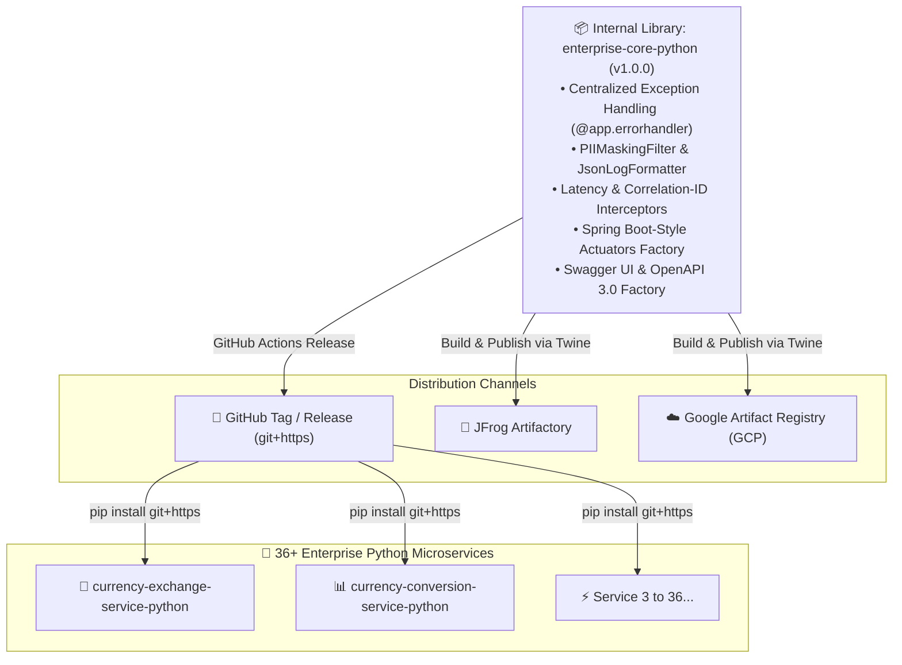

# 🏢 Enterprise Core Python Library (`enterprise-core-python`)

[](pyproject.toml)
[](https://www.python.org/)
[](#)

> **Architectural Pattern**: Shared Enterprise Starter Library (Spring Boot Starter Equivalent)  
> **Java / Maven Equivalence**: `spring-boot-starter` + Common Enterprise Parent / BOM Jar  
> **Target Problem**: Eliminates hundreds of lines of duplicate boilerplate (error handling, JSON logging, PII masking, latency interceptors, health actuators, Swagger UI) across all 36+ Python microservices.

---

## 📑 Table of Contents
1. [Overview & Architecture](#-overview--architecture)
2. [What is Bundled in `enterprise_core`](#-what-is-bundled-in-enterprise_core)
3. [How Microservices Consume This Library](#-how-microservices-consume-this-library)
   - [Dependency Specification (`requirements.txt` or `pyproject.toml`)](#1-dependency-specification-requirementstxt-or-pyprojecttoml)
   - [Application Bootstrap (`app.py`)](#2-in-microservice-application-bootstrap-apppy)
   - [Domain Exceptions](#3-in-microservice-domain-exceptions)
4. [Automated Release Workflow](#-automated-release-workflow)
5. [Enterprise Artifact Publishing Guide (JFrog, Nexus, Google Artifact Registry)](#-enterprise-artifact-publishing-guide)
6. [Local Development & Monorepo Testing](#-local-development--monorepo-testing)

---

## 🌟 Overview & Architecture

In large-scale microservice platforms (36+ services), having each microservice write its own logging configuration, PII scrubber regexes, exception handlers, health endpoints, and Swagger UI wrappers creates:
- **Massive code duplication**: ~400 lines of identical boilerplate copied 36 times = 14,400 redundant lines.
- **Security drift**: Inconsistent PII masking rules and error disclosure risks.
- **Heavy maintenance**: Upgrading an OpenAPI UI version or updating a logging format requires 36 individual PRs.

`enterprise-core-python` acts as the **single internal standard** across the organization:



---

## 📦 What is Bundled in `enterprise_core`

| Module | Core Exports | Description |
| :--- | :--- | :--- |
| `enterprise_core.exception` | `BaseEnterpriseException`<br/>`register_centralized_error_handlers` | Single centralized `@app.errorhandler(Exception)` producing unified JSON error envelopes for domain, HTTP, and unhandled errors. |
| `enterprise_core.logging` | `setup_enterprise_logging`<br/>`PIIMaskingFilter`<br/>`JsonLogFormatter` | High-performance JSON logging with correlation IDs, service tags, and regex scrubbing for emails, payment cards, tokens, and account numbers. |
| `enterprise_core.interceptor`| `register_latency_interceptors` | Injects/propagates `X-Correlation-ID` and records exact millisecond latency `X-Response-Time-Ms`. |
| `enterprise_core.actuator` | `create_actuators_blueprint` | Blueprint factory exposing `/health`, `/health/liveness`, `/health/readiness`, `/info`, and `/metrics` under any context path. |
| `enterprise_core.swagger` | `create_swagger_blueprint` | Blueprint factory providing interactive Swagger UI and serving `/openapi.json` under the service's base context path. |

---

## 🚀 How Microservices Consume This Library

### 1. Dependency Specification (`requirements.txt` or `pyproject.toml`)

Other enterprise microservices consume `enterprise-core-python` directly from GitHub using standard PEP 508 direct reference URLs pinned to release tags:

#### In `requirements.txt`:
```text
enterprise-core-python @ git+https://github.com/amsidhlokhande/enterprise-core-python.git@v1.0.0
```

#### With Optional Dependencies (e.g., AWS Boto3):
```text
enterprise-core-python[aws] @ git+https://github.com/amsidhlokhande/enterprise-core-python.git@v1.0.0
```

#### In `pyproject.toml`:
```toml
[project]
dependencies = [
    "enterprise-core-python @ git+https://github.com/amsidhlokhande/enterprise-core-python.git@v1.0.0",
]
```

#### Via `pip install`:
```bash
pip install "enterprise-core-python @ git+https://github.com/amsidhlokhande/enterprise-core-python.git@v1.0.0"
```

### 2. In Microservice Application Bootstrap (`app.py`)
```python
from flask import Flask
from enterprise_core import (
    setup_enterprise_logging,
    register_centralized_error_handlers,
    register_latency_interceptors,
    create_actuators_blueprint,
    create_swagger_blueprint
)
import constants

def create_app():
    # 1. Initialize logging
    setup_enterprise_logging(service_name=constants.SERVICE_NAME, log_level=constants.LOG_LEVEL)

    app = Flask(__name__)

    # 2. Register interceptors and error handlers
    register_latency_interceptors(app)
    register_centralized_error_handlers(
        app,
        default_internal_error_code=constants.ERR_INTERNAL_CODE,
        default_internal_error_msg=constants.ERR_INTERNAL_MSG
    )

    # 3. Mount Actuators
    actuators_bp = create_actuators_blueprint(
        context_path=constants.CONTEXT_PATH,
        service_name=constants.SERVICE_NAME,
        health_callback=my_service_health_check,
        readiness_callback=my_service_readiness_check
    )
    app.register_blueprint(actuators_bp)

    # 4. Mount Swagger UI
    swagger_bp = create_swagger_blueprint(
        context_path=constants.CONTEXT_PATH,
        openapi_spec=OPENAPI_SPEC_DICT,
        title=f"{constants.SERVICE_NAME} - Swagger UI"
    )
    app.register_blueprint(swagger_bp)

    return app
```

### 3. In Microservice Domain Exceptions
```python
from enterprise_core import BaseEnterpriseException

class RateNotFoundException(BaseEnterpriseException):
    def __init__(self, from_curr: str, to_curr: str):
        super().__init__(
            error_code="CESP_001",
            error_message="Exchange rate not available",
            error_detail_message=f"No rate found for {from_curr}->{to_curr}",
            status_code=404,
            details=[f"Pair {from_curr}->{to_curr} is not supported."]
        )
```

---

## 🚀 Automated Release Workflow

The library includes an automated GitHub Actions release workflow in [`.github/workflows/release.yml`](.github/workflows/release.yml):

- **Triggers**:
  - Pushes matching git tags: `'v*.*.*'`
  - Direct pushes or merges to `main` branch
  - Manual triggers via `workflow_dispatch`
- **Release Automation**:
  1. **Unit Testing**: Runs test suite under pytest (`pip install -e .` & `pytest tests/ -v`).
  2. **Distribution Packaging**: Builds standard wheel (`.whl`) and source archive (`.tar.gz`) via `python -m build`.
  3. **Metadata Verification**: Audits package integrity using `twine check dist/*`.
  4. **GitHub Release Publication**: Automatically determines the release tag (`refs/tags/v*` or extracts version from `pyproject.toml` such as `v1.0.0`), generates release notes, and attaches all distribution artifacts via `softprops/action-gh-release@v2`.

---

## 🏛️ Enterprise Artifact Publishing Guide

When deploying across 36+ repositories, publish the built `.whl` to your enterprise repository.

### Option A: JFrog Artifactory
```bash
# 1. Configure .pypirc
cat <<EOF > ~/.pypirc
[distutils]
index-servers = artifactory

[artifactory]
repository = https://your-company.jfrog.io/artifactory/api/pypi/pypi-local
username = deploy-user
password = <YOUR_API_TOKEN>
EOF

# 2. Build and upload
pip install build twine
python -m build
twine upload -r artifactory dist/*
```

**In your 36 microservices (`requirements.txt` or Dockerfile)**:
```dockerfile
RUN pip install enterprise-core-python \
    --extra-index-url https://deploy-user:<TOKEN>@your-company.jfrog.io/artifactory/api/pypi/pypi-local/simple
```

---

### Option B: Google Cloud Artifact Registry (GCP)
```bash
# 1. Create Python Package Repository in GCP
gcloud artifacts repositories create python-shared-repo \
    --repository-format=python \
    --location=us-central1 \
    --description="Enterprise Shared Python Packages"

# 2. Upload with Google Keyring
pip install keyring keyrings.google-artifactregistry-auth twine
python -m build
twine upload --repository-url https://us-central1-python.pkg.dev/YOUR_PROJECT_ID/python-shared-repo/ dist/*
```

**In your microservice Dockerfiles**:
```dockerfile
RUN pip install keyrings.google-artifactregistry-auth && \
    pip install enterprise-core-python \
    --extra-index-url https://us-central1-python.pkg.dev/YOUR_PROJECT_ID/python-shared-repo/simple/
```

---

### Option C: Sonatype Nexus
```bash
twine upload --repository-url http://nexus.internal:8081/repository/pypi-hosted/ dist/*
```

---

## 💻 Local Development & Monorepo Testing

For local development or monorepos before publishing to JFrog:
```bash
# Editable install into current virtualenv
pip install -e ./enterprise-core-python

# Run test suite (9 tests covering all core modules)
pytest enterprise-core-python/tests -v
```
